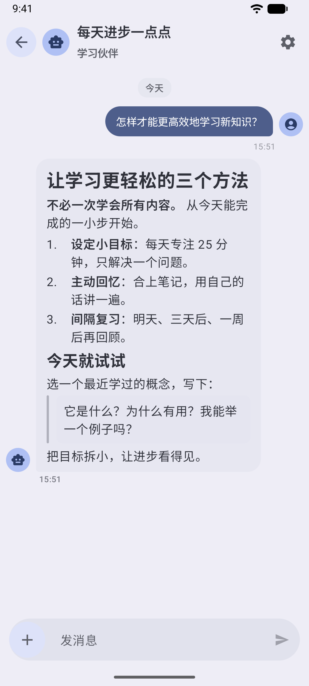
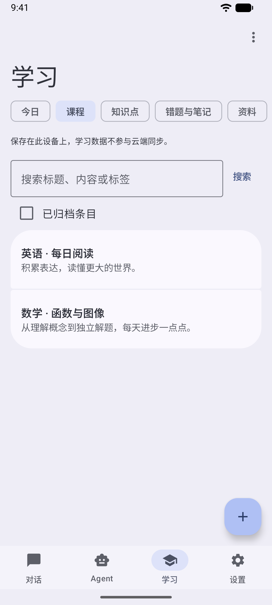
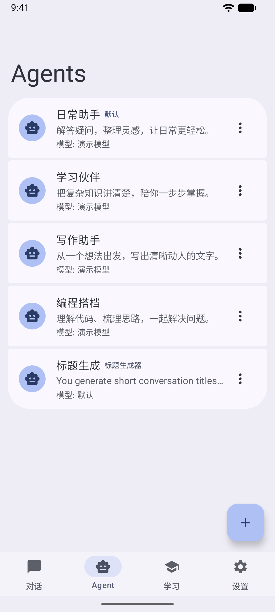

**English** | [简体中文](README.zh-CN.md)

[![Contributors][contributors-shield]][contributors-url]
[![Stars][stars-shield]][stars-url]
[![Issues][issues-shield]][issues-url]
[![Apache License][license-shield]][license-url]

  
  <h1>Messenger</h1>
  
Your AI chat and learning companion.

  

    <a href="https://github.com/originalFactor/Messenger/releases/latest">Download</a>
    ·
    <a href="https://github.com/originalFactor/Messenger/issues">Report an issue</a>
  

[About](#about-the-project) · [Screenshots](#screenshots) · [Getting started](#getting-started) · [Usage](#usage) · [Contributing](#contributing)

## About The Project

Messenger is an open-source AI chat app for Android and desktop, with a Wear OS companion. Bring your own API key and choose the models you want to use.

- **Chat your way** — Connect multiple providers and create custom assistants.
- **Read comfortably** — Stream replies with formatted text, code, and math.
- **Learn and review** — Organize courses, notes, mistakes, exercises, and study plans.
- **Keep control** — Store conversations locally; enable cloud sync when you want it.
- **Use tools** — Let assistants work with files and terminal commands with your permission.

The client is free. Model providers and optional cloud services may charge for usage. AI replies require access to your configured provider.

### Built With

[Kotlin](https://kotlinlang.org/) · [Jetpack Compose](https://developer.android.com/jetpack/compose) · [Compose Multiplatform](https://www.jetbrains.com/lp/compose-multiplatform/) · [Material 3](https://m3.material.io/) · [Rust](https://www.rust-lang.org/) · [SQLite](https://www.sqlite.org/)

## Screenshots

  
  
  

Android · Demo content · Chat / Learning / Assistants

## Getting Started

### Download

Get the app from [GitHub Releases](https://github.com/originalFactor/Messenger/releases/latest).

| Device | Download |
| --- | --- |
| Android 11+ | Main Android APK |
| Wear OS | Wear APK; also install Messenger on your phone |
| Windows | MSI installer |
| macOS (Apple Silicon) | DMG installer |
| Linux | Deb or Arch package |

For terminal tools on Android, also install the matching **Messenger Runtime** APK.

### First chat

1. Open Messenger and add a provider with your API key.
2. Choose a model for your assistant.
3. Start a conversation and send your first message.

## Usage

- **Assistants** — Create separate assistants for writing, coding, or studying.
- **Learning** — Save study material and plan reviews. See the [Learning guide](LEARNING.md).
- **Tools** — Enable tools for an assistant when needed; choose read-only or writable access.
- **Wear OS** — Configure providers, models, and assistants on your phone, then chat from your watch.
- **Cloud sync** — Sign in optionally to sync supported data across devices.

Conversations are stored on your device. Model requests go to your selected provider; enabling cloud sync uploads supported data to your account.

## Contributing

[Report bugs or suggest features](https://github.com/originalFactor/Messenger/issues), improve translations, or submit a pull request. For development setup and project conventions, see [AGENTS.md](AGENTS.md).

### Contributors

## License

[Apache License 2.0](LICENSE).

## Contact

[Project](https://github.com/originalFactor/Messenger) · [Issues](https://github.com/originalFactor/Messenger/issues)

## Acknowledgments

- [llm-typewriter](https://github.com/originalFactor/llm-typewriter) — Streaming Markdown, code, and math.
- [Compose LaTeX](https://github.com/huarangmeng/latex) — Math rendering.
- [Jetpack Compose](https://developer.android.com/jetpack/compose), [Compose Multiplatform](https://www.jetbrains.com/lp/compose-multiplatform/), and [Material 3](https://m3.material.io/) — App interface.
- [Axum](https://github.com/tokio-rs/axum) and [OkHttp](https://square.github.io/okhttp/) — Networking.
- [Best-README-Template](https://github.com/othneildrew/Best-README-Template) — Original README template.

[contributors-shield]: https://img.shields.io/github/contributors/originalFactor/Messenger.svg?style=for-the-badge
[contributors-url]: https://github.com/originalFactor/Messenger/graphs/contributors
[stars-shield]: https://img.shields.io/github/stars/originalFactor/Messenger.svg?style=for-the-badge
[stars-url]: https://github.com/originalFactor/Messenger/stargazers
[issues-shield]: https://img.shields.io/github/issues/originalFactor/Messenger.svg?style=for-the-badge
[issues-url]: https://github.com/originalFactor/Messenger/issues
[license-shield]: https://img.shields.io/github/license/originalFactor/Messenger.svg?style=for-the-badge
[license-url]: https://github.com/originalFactor/Messenger/blob/main/LICENSE
