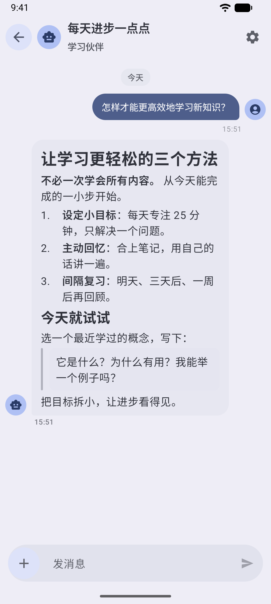
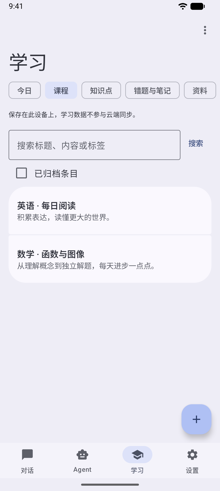
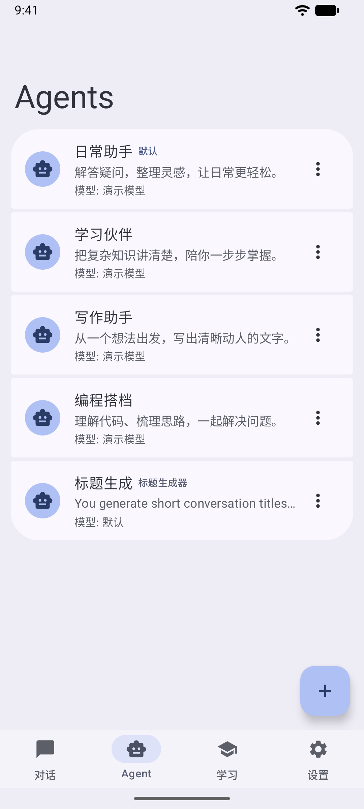

[English](README.md) | **简体中文**

[![Contributors][contributors-shield]][contributors-url]
[![Stars][stars-shield]][stars-url]
[![Issues][issues-shield]][issues-url]
[![Apache License][license-shield]][license-url]

  
  <h1>Messenger</h1>
  
你的 AI 聊天与学习助手。

  

    <a href="https://github.com/originalFactor/Messenger/releases/latest">下载</a>
    ·
    <a href="https://github.com/originalFactor/Messenger/issues">反馈</a>
  

[项目介绍](#about) · [界面预览](#screenshots) · [开始使用](#getting-started) · [使用方法](#usage) · [参与贡献](#contributing)

## 项目介绍

Messenger 是一款开源 AI 聊天应用，支持 Android 和桌面端，并提供 Wear OS 配套应用。使用自己的 API 密钥，自由选择模型。

- **自由聊天**：连接多个服务商，创建不同用途的助手。
- **舒适阅读**：流式显示回复，支持排版、代码和数学公式。
- **学习复习**：整理课程、笔记、错题、练习和学习计划。
- **自主掌控**：对话保存在本地，云同步按需开启。
- **工具协作**：授权助手处理文件、执行终端命令。

客户端免费。模型服务商和可选云服务可能收费。获取 AI 回复需要连接所配置的服务商。

### 技术栈

[Kotlin](https://kotlinlang.org/) · [Jetpack Compose](https://developer.android.com/jetpack/compose) · [Compose Multiplatform](https://www.jetbrains.com/lp/compose-multiplatform/) · [Material 3](https://m3.material.io/) · [Rust](https://www.rust-lang.org/) · [SQLite](https://www.sqlite.org/)

## 界面预览

  
  
  

Android 应用界面 · 演示内容 · 聊天 / 学习 / 智能体

## 开始使用

### 下载

前往 [GitHub Releases](https://github.com/originalFactor/Messenger/releases/latest) 下载应用。

| 设备 | 下载内容 |
| --- | --- |
| Android 11 及以上 | Android 主应用 APK |
| Wear OS | Wear APK；手机也需安装 Messenger |
| Windows | MSI 安装包 |
| macOS（Apple Silicon） | DMG 安装包 |
| Linux | Deb 或 Arch 安装包 |

Android 如需终端工具，请同时安装配套的 **Messenger Runtime** APK。

### 开始聊天

1. 打开 Messenger，添加服务商并填写 API 密钥。
2. 为助手选择模型。
3. 新建对话，发送第一条消息。

## 使用方法

- **智能体**：为写作、编程、学习创建专属助手。
- **学习**：保存学习材料，安排复习。详见[学习指南](LEARNING.md)。
- **工具**：按需为助手启用工具，选择只读或可写权限。
- **手表**：在手机配置服务商、模型和智能体，再从手表聊天。
- **云同步**：按需登录账号，在设备间同步受支持的数据。

对话保存在设备上。模型请求发送至所选服务商；开启云同步后，受支持的数据会上传至你的账号。

## 参与贡献

欢迎[反馈问题或提出建议](https://github.com/originalFactor/Messenger/issues)、改进翻译或提交 Pull Request。开发配置与项目约定见 [AGENTS.md](AGENTS.md)。

### 贡献者

## 许可证

[Apache License 2.0](LICENSE)。

## 联系方式

[项目主页](https://github.com/originalFactor/Messenger) · [问题反馈](https://github.com/originalFactor/Messenger/issues)

## 致谢

- [llm-typewriter](https://github.com/originalFactor/llm-typewriter)：流式 Markdown、代码和公式显示。
- [Compose LaTeX](https://github.com/huarangmeng/latex)：数学公式渲染。
- [Jetpack Compose](https://developer.android.com/jetpack/compose)、[Compose Multiplatform](https://www.jetbrains.com/lp/compose-multiplatform/) 和 [Material 3](https://m3.material.io/)：应用界面。
- [Axum](https://github.com/tokio-rs/axum) 和 [OkHttp](https://square.github.io/okhttp/)：网络通信。
- [Best-README-Template](https://github.com/othneildrew/Best-README-Template)：原始 README 模板。

[contributors-shield]: https://img.shields.io/github/contributors/originalFactor/Messenger.svg?style=for-the-badge
[contributors-url]: https://github.com/originalFactor/Messenger/graphs/contributors
[stars-shield]: https://img.shields.io/github/stars/originalFactor/Messenger.svg?style=for-the-badge
[stars-url]: https://github.com/originalFactor/Messenger/stargazers
[issues-shield]: https://img.shields.io/github/issues/originalFactor/Messenger.svg?style=for-the-badge
[issues-url]: https://github.com/originalFactor/Messenger/issues
[license-shield]: https://img.shields.io/github/license/originalFactor/Messenger.svg?style=for-the-badge
[license-url]: https://github.com/originalFactor/Messenger/blob/main/LICENSE
